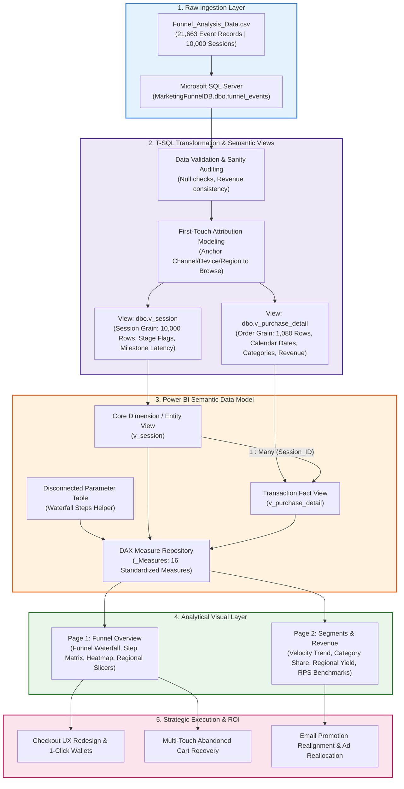
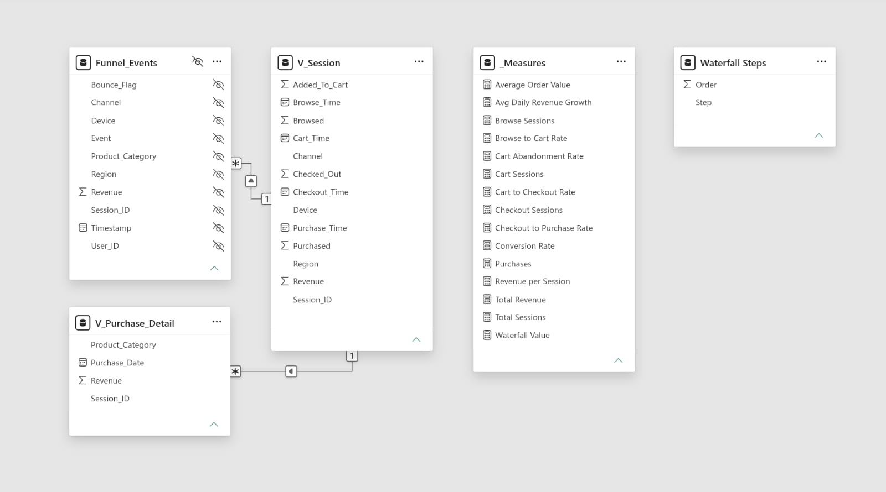

# E-Commerce Marketing Funnel & Conversion Analytics

> An enterprise-grade, end-to-end Business Intelligence solution engineered with **Microsoft SQL Server (T-SQL)** and **Power BI** to evaluate customer conversion journeys across marketing channels, devices, and geographies. This project pinpoints multi-stage funnel drop-offs, diagnoses cart abandonment bottlenecks, analyzes category revenue yield, and delivers an executive growth roadmap.

## Table of Contents
1. [Executive Summary & Problem Statement](#1-executive-summary--problem-statement)
2. [Key Performance Indicators (KPIs)](#2-key-performance-indicators-kpis)
3. [End-to-End Solution Architecture](#3-end-to-end-solution-architecture)
4. [Dataset Profile & Data Dictionary](#4-dataset-profile--data-dictionary)
5. [T-SQL Pipeline & Sessionization Layer](#5-t-sql-pipeline--sessionization-layer)
6. [Power BI Data Model Architecture](#6-power-bi-data-model-architecture)
7. [Power BI DAX Measures Library](#7-power-bi-dax-measures-library)
8. [Interactive Dashboard Walkthrough](#8-interactive-dashboard-walkthrough)
   - [Page 1: Funnel Stage & Channel Performance Overview](#page-1-funnel-stage--channel-performance-overview)
   - [Page 2: Segment & Revenue Performance Overview](#page-2-segment--revenue-performance-overview)
9. [Deep-Dive Analytical Insights](#9-deep-dive-analytical-insights)
10. [Strategic Action Plan & Value Realization](#10-strategic-action-plan--value-realization)
11. [Step-by-Step Installation & Reproduction Guide](#11-step-by-step-installation--reproduction-guide)
12. [Repository Structure](#12-repository-structure)
13. [Technology Stack](#13-technology-stack)
14. [Author & Attribution](#14-author--attribution)

---

## 1. Executive Summary & Problem Statement

### The Business Challenge
In digital commerce, customer acquisition cost (CAC) continues to escalate across all primary marketing channels. Driving raw traffic to a website is futile if downstream customer friction prevents checkout completion. 

During **October 2025**, the platform logged **10,000 distinct customer sessions** spanning **21,663 user interactions**, resulting in **₹1,176,406** in gross merchandise value (GMV). However, a high-level conversion rate of only **10.80%** revealed that nearly **89% of all potential buyers left without completing a purchase**. Furthermore, **84.70% of shoppers who added items to their shopping cart abandoned it**, indicating severe revenue leakage.

### Strategic Objectives
1. **Friction Point Identification:** Pinpoint the exact funnel transition where shoppers drop out (Browse → Cart vs. Cart → Checkout vs. Checkout → Purchase).
2. **Attribution & Channel Efficiency:** Evaluate conversion performance across Inbound Channels (Organic, Google Ads, Email, Social Media) and Device Form Factors (Desktop, Mobile, Tablet).
3. **Revenue Velocity & Portfolio Balance:** Assess whether revenue is overly dependent on specific merchandise categories or geographic regions, and determine daily revenue trends.
4. **Actionable Growth Levers:** Formulate an empirical, prioritized optimization roadmap to reclaim lost cart value and lift overall platform profitability.

---

## 2. Key Performance Indicators (KPIs)

| Metric | Oct 2025 Actual | Benchmark / Target | Business Impact & Interpretation |
| :--- | :---: | :---: | :--- |
| **Total Sessions** | **10,000** | — | Top-of-funnel customer traffic volume in October 2025. |
| **Total Purchases** | **1,080** | — | Successful order transactions resulting in verified revenue. |
| **Overall Conversion Rate** | **10.80%** | **12.50%** | Blended ratio of completed purchases to total initiated sessions. |
| **Cart Abandonment Rate** | **84.70%** | **< 70.0%** | Percentage of cart-initiating sessions (7,059) that exited without purchasing. |
| **Checkout-to-Purchase Rate** | **30.65%** | **> 45.0%** | **Critical friction point:** 69.35% of checkout sessions fail at payment. |
| **Gross Revenue** | **₹11,76,406** | — | Total monetary sales captured across the 1,080 purchase orders. |
| **Average Order Value (AOV)** | **₹1,089.26** | **₹1,150.00** | Mean revenue generated per completed customer transaction. |
| **Revenue Per Session (RPS)** | **₹117.64** | **₹135.00** | Net economic monetization yield across all incoming traffic. |
| **Avg Daily Revenue Growth** | **+4.21%** | **> 0.0%** | Velocity increase in daily run-rate comparing second half (H2) to first half (H1). |

---

## 3. End-to-End Solution Architecture

The project implements a modern BI architecture adhering to **Roche's Maxim of Data Transformation**: *"Data should be transformed as far upstream as possible and as far downstream as necessary."*



---

## 4. Dataset Profile & Data Dictionary

### Dataset Overview
The dataset contains **21,663 event-level rows** logging web interactions for **10,000 unique users** across **10,000 distinct sessions** throughout October 2025 (`2025-10-01 19:30:17` to `2025-10-31 19:25:15`).
- **Data Completeness:** 100% complete (0 nulls or missing values).
- **Funnel Progression:** Every session strictly begins with a `Browse` event.

### Funnel Volume & Step Drop-off Table
| Funnel Milestone | Event Count | Reach % | Step Conversion % | Sessions Lost | Drop-off Rate | Nature of Drop-off |
| :--- | :---: | :---: | :---: | :---: | :---: | :--- |
| **1. Browse** | 10,000 | 100.0% | Baseline | — | — | Top-of-Funnel Entrance |
| **2. Add to Cart** | 7,059 | 70.59% | **70.59%** | -2,941 | 29.41% | Catalog / Product Intent |
| **3. Checkout** | 3,524 | 35.24% | **49.92%** | **-3,535** | **50.08%** | **Largest Absolute Volume Leak** |
| **4. Purchase** | 1,080 | 10.80% | **30.65%** | -2,444 | **69.35%** | **Steepest Step Failure Rate** |

### Data Dictionary (`dbo.funnel_events`)
| Field Name | Data Type | Nullable | Cardinality | Permissible / Example Values | Description |
| :--- | :--- | :---: | :---: | :--- | :--- |
| `User_ID` | `VARCHAR(10)` | No | 10,000 | `USR00001` - `USR10000` | Persistent visitor identifier. |
| `Session_ID` | `VARCHAR(10)` | No | 10,000 | `SES00001` - `SES10000` | Unique browsing session identifier (Primary Key candidate). |
| `Event` | `VARCHAR(20)` | No | 4 | `Browse`, `Add to Cart`, `Checkout`, `Purchase` | Milestone achieved in the user journey. |
| `Timestamp` | `DATETIME2` | No | 21,663 | `2025-10-01 19:30:17` to `2025-10-31 19:25:15` | Timestamp recording event occurrence. |
| `Device` | `VARCHAR(10)` | No | 3 | `Desktop`, `Mobile`, `Tablet` | Client device form-factor. |
| `Region` | `VARCHAR(10)` | No | 4 | `East`, `North`, `South`, `West` | Geographical location of user. |
| `Channel` | `VARCHAR(20)` | No | 4 | `Email`, `Google Ads`, `Organic`, `Social Media` | Inbound traffic acquisition source. |
| `Product_Category`| `VARCHAR(20)` | No | 5 | `Beauty`, `Electronics`, `Fashion`, `Home`, `Sports` | Product vertical browsed or purchased. |
| `Revenue` | `DECIMAL(10,2)`| No | 1,081 | `0.00` (Browse/Cart/Chk), `₹201.26` – `₹1,998.51` (Purchase) | Transaction value in INR. Strictly `0.00` on non-purchase events. |
| `Bounce_Flag` | `VARCHAR(3)` | No | 2 | `Yes`, `No` | Synthesized non-purchase indicator; excluded from core analytics. |

---

## 5. T-SQL Pipeline & Sessionization Layer

All data validation, session pivoting, and attribution stabilization logic are written in T-SQL (`Funnel_Analysis.sql`).

### 1. Data Quality Auditing & Validation
Before generating analytical views, an automated integrity audit validates volume, null values, and financial consistency:

```sql
USE MarketingFunnelDB;
GO

SELECT
    COUNT(*) AS Total_Rows,
    COUNT(DISTINCT Session_ID) AS Total_Sessions,
    SUM(CASE WHEN Session_ID IS NULL OR Event IS NULL OR [Timestamp] IS NULL
              OR Channel IS NULL OR Device IS NULL OR Region IS NULL
              OR Product_Category IS NULL OR Revenue IS NULL
        THEN 1 ELSE 0 END) AS Missing_Rows,
    SUM(CASE WHEN (Event = 'Purchase' AND Revenue <= 0)
              OR (Event <> 'Purchase' AND Revenue <> 0)
        THEN 1 ELSE 0 END) AS Invalid_Revenue_Rows
FROM dbo.funnel_events;
GO
```
*Validation Result:* `Missing_Rows = 0`, `Invalid_Revenue_Rows = 0`. Complete data integrity confirmed.

### 2. First-Touch Attribution & Sessionization View (`dbo.v_session`)
In multi-event clickstream data, attributes (such as device or channel) can occasionally drift across intermediate hops. To maintain referential stability, marketing attribution is anchored to the initial **Browse** event using conditional aggregation:

```sql
CREATE OR ALTER VIEW dbo.v_session AS
SELECT
    Session_ID,
    MAX(CASE WHEN Event = 'Browse' THEN Channel END)          AS Channel,
    MAX(CASE WHEN Event = 'Browse' THEN Device END)           AS Device,
    MAX(CASE WHEN Event = 'Browse' THEN Region END)           AS Region,
    MAX(CASE WHEN Event = 'Browse' THEN [Timestamp] END)      AS Browse_Time,
    MAX(CASE WHEN Event = 'Add to Cart' THEN [Timestamp] END) AS Cart_Time,
    MAX(CASE WHEN Event = 'Checkout' THEN [Timestamp] END)    AS Checkout_Time,
    MAX(CASE WHEN Event = 'Purchase' THEN [Timestamp] END)    AS Purchase_Time,
    MAX(CASE WHEN Event = 'Browse' THEN 1 ELSE 0 END)         AS Browsed,
    MAX(CASE WHEN Event = 'Add to Cart' THEN 1 ELSE 0 END)    AS Added_To_Cart,
    MAX(CASE WHEN Event = 'Checkout' THEN 1 ELSE 0 END)       AS Checked_Out,
    MAX(CASE WHEN Event = 'Purchase' THEN 1 ELSE 0 END)       AS Purchased,
    SUM(Revenue)                                              AS Revenue
FROM dbo.funnel_events
GROUP BY Session_ID;
GO
```

### 3. Granular Purchase Fact View (`dbo.v_purchase_detail`)
Isolates converted orders to allow high-speed slicing across merchandise categories and daily time intelligence:

```sql
CREATE OR ALTER VIEW dbo.v_purchase_detail AS
SELECT
    Session_ID,
    CAST([Timestamp] AS DATE) AS Purchase_Date,
    Product_Category,
    Revenue
FROM dbo.funnel_events
WHERE Event = 'Purchase';
GO
```

---

## 6. Power BI Data Model Architecture

The semantic model in `Marketing_Funnel_Conversion_Analysis.pbix` implements a clean star schema with single cross-filter directions, preventing circular filter paths and optimizing VertiPaq in-memory compression.



### Model Entities & Relationships
1. **`V_Session` (Core Dimension / Entity Table):**
   - 10,000 rows (1 row per session). Primary Key: `Session_ID`.
   - Directly drives report slicers (`Channel`, `Device`, `Region`).
2. **`V_Purchase_Detail` (Transaction Fact Table):**
   - 1,080 rows (1 row per purchase). Foreign Key: `Session_ID`.
   - Relationship: `V_Session (1)` → `V_Purchase_Detail (*)` with **Single Cross-Filter Direction**.
3. **`Funnel_Events` (Staging Table):**
   - 21,663 rows. Preserved for auditability but hidden from end-user reporting.
4. **`Waterfall Steps` (Disconnected Parameter Table):**
   - Unconnected helper table containing `Order` (1–5) and `Step` (`Browse`, `Cart Drop`, `Checkout Drop`, `Payment Drop`, `Total`).
   - Slices the custom DAX `[Waterfall Value]` measure without altering the core model context.
5. **`_Measures` (Calculation Group):**
   - Dedicated measure container housing all DAX business logic.

---

## 7. Power BI DAX Measures Library

All business calculations are standardized in `_Measures` using defensive DAX (`DIVIDE` with alternate zero defaults) to prevent `#DIV/0!` errors.

### Core Volume & Conversion Rates
```dax
// 1. Total Session Volume
Total Sessions = COUNTROWS('V_Session')

// 2. Completed Orders
Purchases = SUM('V_Session'[Purchased])

// 3. End-to-End Conversion Rate
Conversion Rate = 
DIVIDE([Purchases], [Total Sessions], 0)

// 4. Cart Abandonment Rate
Cart Abandonment Rate = 
DIVIDE(
    SUM('V_Session'[Added_To_Cart]) - [Purchases],
    SUM('V_Session'[Added_To_Cart]),
    0
)
```

### Stage-by-Stage Step Conversion Rates
```dax
// 5. Browse to Cart Step Rate
Browse to Cart Rate = 
DIVIDE(SUM('V_Session'[Added_To_Cart]), SUM('V_Session'[Browsed]), 0)

// 6. Cart to Checkout Step Rate
Cart to Checkout Rate = 
DIVIDE(SUM('V_Session'[Checked_Out]), SUM('V_Session'[Added_To_Cart]), 0)

// 7. Checkout to Purchase Step Rate
Checkout to Purchase Rate = 
DIVIDE([Purchases], SUM('V_Session'[Checked_Out]), 0)
```

### Custom Funnel Waterfall Dynamic Routing
```dax
// 8. Dynamic Measure for Disconnected Waterfall Visual
Waterfall Value = 
VAR CurrentStep = SELECTEDVALUE('Waterfall Steps'[Step])
RETURN
    SWITCH(
        CurrentStep,
        "Browse", [Total Sessions],
        "Cart Drop", -(SUM('V_Session'[Browsed]) - SUM('V_Session'[Added_To_Cart])),
        "Checkout Drop", -(SUM('V_Session'[Added_To_Cart]) - SUM('V_Session'[Checked_Out])),
        "Payment Drop", -(SUM('V_Session'[Checked_Out]) - [Purchases]),
        "Total", [Purchases],
        BLANK()
    )
```

### Financial Performance & Period-over-Period Velocity
```dax
// 9. Gross Sales
Total Revenue = SUM('V_Purchase_Detail'[Revenue])

// 10. Average Order Value (AOV)
Average Order Value = 
DIVIDE([Total Revenue], [Purchases], 0)

// 11. Revenue Per Session (RPS)
Revenue per Session = 
DIVIDE([Total Revenue], [Total Sessions], 0)

// 12. Normalized Daily Run-Rate Growth (Oct 16-31 vs Oct 1-15)
Avg Daily Revenue Growth = 
VAR FirstHalfRev = 
    CALCULATE([Total Revenue], 'V_Purchase_Detail'[Purchase_Date] <= DATE(2025, 10, 15))
VAR SecondHalfRev = 
    CALCULATE([Total Revenue], 'V_Purchase_Detail'[Purchase_Date] > DATE(2025, 10, 15))
VAR FirstHalfDailyAvg = DIVIDE(FirstHalfRev, 15.0, 0)
VAR SecondHalfDailyAvg = DIVIDE(SecondHalfRev, 16.0, 0)
RETURN
    DIVIDE(SecondHalfDailyAvg - FirstHalfDailyAvg, FirstHalfDailyAvg, 0)
```

---

## 8. Interactive Dashboard Walkthrough

The Power BI dashboard is styled like a modern SaaS web application with a charcoal top navigation bar (`#1E1E1E`), honey amber brand accents (`#E08726`), coral attrition bars (`#DB5A62`), and forest green success highlights (`#2E7D32`).

---

### Page 1: Funnel Stage & Channel Performance Overview
*Answers: At which stage do sessions drop off, and how do channels, devices, and regions compare on conversion?*


#### Visual Elements & Interactivity:
1. **Top KPI Scorecards:**
   - **Total Sessions:** `10,000`
   - **Purchases:** `1,080`
   - **Conversion Rate:** `10.8%`
   - **Cart Abandonment Rate:** `84.7%`
2. **Funnel Waterfall Chart (Mid-Left):**
   - Shows progressive drop-off: **Browse** (`10,000`) → **Cart Drop** (`-2,941`) → **Checkout Drop** (`-3,535`, largest drop) → **Payment Drop** (`-2,444`, weakest step) → **Purchases** (`1,080`).
3. **Step Conversion by Channel Matrix (Mid-Right):**
   - Multi-column heatmap detailing Browse → Cart, Cart → Checkout, and Checkout → Purchase rates per channel.
   - Highlights that Email has the highest Cart-to-Checkout rate (`50.4%`) but the lowest Checkout-to-Purchase rate (`29.0%`).
4. **Device × Channel Conversion Heatmap (Bottom-Left):**
   - 2D cross-tab matrix revealing top performers (**Desktop + Google Ads at 12.0%**) and lowest performers (**Tablet + Email at 9.7%**).
5. **Conversion by Region Bar Chart (Bottom-Right):**
   - Slices regional conversion with a dashed benchmark line at the 10.8% average: **South** (`11.3%`), **East** (`11.1%`), **North** (`10.4%`), **West** (`10.4%`).
6. **Global Slicers & Reset:**
   - Dropdown slicers for `Channel`, `Device`, and `Region` with an instant `"Clear all slicers"` button.

---

### Page 2: Segment & Revenue Performance Overview
*Answers: Which categories, regions, and channels drive revenue, and how has revenue trended over time?*


#### Visual Elements & Interactivity:
1. **Financial KPI Scorecards:**
   - **Total Revenue:** `₹11,76,406` (Formatted in INR)
   - **Average Order Value (AOV):** `₹1,089`
   - **Revenue Per Session (RPS):** `₹117.64`
   - **Avg Daily Revenue Growth:** `+4.2%` (H2 normalized daily growth over H1)
2. **Daily Revenue Trend Line/Area Chart (Mid-Left):**
   - Visualizes day-to-day revenue volatility across October 2025, highlighting revenue peaks on Oct 5 (`~₹55K`), Oct 14 (`~₹52K`), and Oct 25–26 (`~₹52K`).
3. **Revenue by Product Category (Mid-Right):**
   - Demonstrates a remarkably balanced product revenue portfolio:
     - **Electronics:** `₹256K` (21.8% share, AOV ₹1,118.06)
     - **Fashion:** `₹245K` (20.8% share, AOV ₹1,097.58)
     - **Home:** `₹230K` (19.6% share, AOV ₹1,085.66)
     - **Sports:** `₹228K` (19.4% share, AOV ₹1,059.94)
     - **Beauty:** `₹218K` (18.5% share, AOV ₹1,082.39)
4. **Revenue by Region Bar Chart (Bottom-Left):**
   - Correlates directly with regional conversion: **South** (`₹3,11,019`), **East** (`₹3,01,767`), **North** (`₹2,88,028`), **West** (`₹2,75,592`). South and East generate **52.1%** of all sales.
5. **Revenue per Session by Channel (Bottom-Right):**
   - Benchmarks revenue yield per visitor against the ₹117.64 site average:
     - **Organic:** `₹122.44` *(Top)*
     - **Google Ads:** `₹122.18`
     - **Social Media:** `₹114.78`
     - **Email:** `₹110.93` *(Lowest)*

---

## 9. Deep-Dive Analytical Insights

### 1. The Post-Cart Friction Crisis (Checkout vs. Payment Leak)
- **Top of Funnel is Strong:** 70.59% of browsing sessions result in an item being added to the cart, indicating high product interest, competitive catalog pricing, and compelling imagery.
- **The True Bottleneck:** The primary friction point is **not** browsing interest; it is post-cart progression.
  - **3,535 sessions drop between Cart and Checkout** (50.08% loss).
  - **2,444 sessions drop between Checkout and Purchase** (69.35% loss).
  - High-intent shoppers who already entered checkout fail to convert at payment, indicating technical checkout friction, unexpected delivery fees, or limited payment options.

### 2. The "Email Friction Paradox"
- **The Paradox:** Email traffic exhibits the **highest Cart-to-Checkout conversion rate (50.40%)** across all acquisition channels, yet collapses to the **lowest Checkout-to-Purchase rate (28.96%)** and the lowest Revenue per Session (`₹110.93`).
- **Root Causes:**
  1. *Promo Code Failure:* Email promotions often feature discount codes that fail to auto-apply at checkout, frustrating bargain-seeking subscribers.
  2. *In-App Browser Restraints:* Email links opened within mobile mail clients (Gmail, Outlook) often fail to integrate smoothly with native digital wallets (Apple Pay, UPI) or break payment gateways.

### 3. Cross-Segment Synergies (Device × Channel)
- **Desktop + Google Ads (11.99% ~ 12.0% CVR):** High-intent commercial search queries paired with full-screen desktop navigation create the highest conversion rate on the platform.
- **Tablet + Email (9.71% ~ 9.7% CVR):** Underperforming viewport scaling and touch-keyboard input fatigue during checkout compound into the weakest conversion rate in the business.

### 4. Revenue Portfolio Stability
- Unlike businesses dependent on a single "hero" product or seasonal vertical, revenue is split almost evenly (~20% per category) across Electronics, Fashion, Home, Sports, and Beauty.
- Growth cannot be achieved simply by pushing one product line; it requires systematic conversion rate optimization (CRO) and average order value (AOV) expansion.

---

## 10. Strategic Action Plan & Value Realization

### A. Three-Horizon Tactical Roadmap

| Horizon | Focus Area | Root Problem Identified | Tactical Action Plan | Target KPI Impact | Timeline | Priority |
| :--- | :--- | :--- | :--- | :--- | :---: | :---: |
| **Horizon 1** | **Payment & Checkout UX** | 69.35% drop-off at payment (2,444 checkout sessions lost) | Deploy 1-click express wallets (Apple Pay, Google Pay, UPI); enable guest checkout; introduce fallback payment gateways to eliminate timeouts. | Lift Checkout-to-Purchase from 30.6% to > 36.0% | Days 1–30 | **P0 (Immediate)** |
| **Horizon 1** | **Cost Transparency** | 50.08% drop-off between Cart and Checkout (3,535 carts lost) | Display dynamic shipping thresholds and estimated delivery dates directly within the slide-out cart drawer before checkout. | Reduce Cart Abandonment by 3.5% | Days 1–30 | **P0 (Immediate)** |
| **Horizon 2** | **Abandoned Cart Recovery** | 5,979 abandoned cart sessions left unrecovered | Implement an automated 3-tier omnichannel recovery sequence (SMS / WhatsApp / Email) triggered at 1 hour, 12 hours, and 24 hours with a 5% incentive. | Recover 4–5% of abandoned carts (+₹180k monthly GMV) | Days 30–60 | **P1 (High)** |
| **Horizon 2** | **Email Experience Realignment** | Email drops from 50.4% at Cart to 29.0% at Payment | Implement automated URL coupon parameters (`?promo=SAVE10`) to auto-populate discounts; optimize mobile webview checkout. | Lift Email CVR from 10.2% to 11.4% | Days 30–60 | **P1 (High)** |
| **Horizon 3** | **Device Optimization** | Tablet conversion lags across all channels (10.38% vs 11.17% Desktop) | Audit tablet touch targets, modal popups, and keyboard input configurations during address entry. | Lift Tablet CVR to > 11.0% | Days 60–90 | **P2 (Medium)** |
| **Horizon 3** | **Ad Spend Reallocation** | Organic (₹122.44) and Google Ads (₹122.18) yield top RPS | Reallocate 15% of underperforming social display ad budget into high-intent Google Ads search campaigns. | +6.0% Blended ROAS | Days 60–90 | **P2 (Ongoing)** |

---

### B. Financial Impact & Value Realization Simulation

| Scenario | Conversion Rate | Orders | Incremental Orders | AOV | Projected Monthly Revenue | Incremental Revenue (% Lift) |
| :--- | :---: | :---: | :---: | :---: | :---: | :---: |
| **Current Baseline** | **10.80%** | **1,080** | — | **₹1,089.26** | **₹11,76,406** | — |
| **Conservative (+1.5% CR Lift)** | 12.30% | 1,230 | +150 | ₹1,089.26 | ₹13,39,790 | **+₹1,63,384 (+13.9%)** |
| **Target (+3.0% CR Lift via CRO)** | 13.80% | 1,380 | +300 | ₹1,089.26 | ₹15,03,179 | **+₹3,26,773 (+27.8%)** |
| **Optimistic (+3.0% CR & +10% AOV)**| 13.80% | 1,380 | +300 | ₹1,198.19 | ₹16,53,502 | **+₹4,77,096 (+40.6%)** |

---

## 11. Step-by-Step Installation & Reproduction Guide

Follow this guide to replicate the full database, views, and Power BI report on your local environment.

### Prerequisites
- **Microsoft SQL Server 2019+** (Developer, Express, or Enterprise Edition) or Azure SQL Database
- **SQL Server Management Studio (SSMS)** or Azure Data Studio
- **Microsoft Power BI Desktop** (Latest Version)

### Step 1: Clone the Repository
```bash
git clone https://github.com/rushita-koradiya/Marketing-Funnel-Conversion-Analysis.git
cd Marketing-Funnel-Conversion-Analysis
```

### Step 2: Create the SQL Database & Ingest Raw Data
1. Launch SSMS and connect to your SQL Server instance (`localhost` or `.\SQLEXPRESS`).
2. Create the target database:
   ```sql
   CREATE DATABASE MarketingFunnelDB;
   GO
   ```
3. Import the CSV dataset into table `dbo.funnel_events` using either:
   - **SSMS Import Flat File Wizard:** Right-click `MarketingFunnelDB` → `Tasks` → `Import Flat File...` → Select `Data/Funnel_Analysis_Data.csv`.
   - **T-SQL BULK INSERT:**
     ```sql
     USE MarketingFunnelDB;
     GO

     CREATE TABLE dbo.funnel_events (
         User_ID VARCHAR(10) NOT NULL,
         Session_ID VARCHAR(10) NOT NULL,
         Event VARCHAR(20) NOT NULL,
         [Timestamp] DATETIME2 NOT NULL,
         Device VARCHAR(10) NOT NULL,
         Region VARCHAR(10) NOT NULL,
         Channel VARCHAR(20) NOT NULL,
         Product_Category VARCHAR(20) NOT NULL,
         Revenue DECIMAL(10,2) NOT NULL,
         Bounce_Flag VARCHAR(3) NOT NULL
     );
     GO

     BULK INSERT dbo.funnel_events
     FROM 'C:\YourPath\Data\Funnel_Analysis_Data.csv'
     WITH (
         FIRSTROW = 2,
         FIELDTERMINATOR = ',',
         ROWTERMINATOR = '\n',
         TABLOCK
     );
     GO
     ```

### Step 3: Run the Transformation Script
Execute `Funnel_Analysis.sql` in SSMS to run the data sanity checks, create the sessionization view `dbo.v_session`, create the purchase fact view `dbo.v_purchase_detail`, and verify analytical queries.

### Step 4: Configure Power BI Desktop
1. Open `Marketing_Funnel_Conversion_Analysis.pbix` in Power BI Desktop.
2. If prompted with a data source connection prompt:
   - Navigate to **Home** → **Transform Data** → **Data Source Settings**.
   - Select the SQL Server connection → Click **Change Source...**.
   - Set **Server** to your local instance name (e.g., `localhost` or `.\SQLEXPRESS`).
   - Set **Database** to `MarketingFunnelDB`.
   - Click **OK** → Click **Close** → Click **Apply Changes**.
3. All visuals, slicers, and DAX measures will immediately populate with the latest data.

---

## 12. Repository Structure

```
Marketing-Funnel-Conversion-Analysis/
│
├── Assets/                                  # Visual assets & dashboard documentation
│   ├── Data_Model.jpeg                     # Power BI star schema relationship model
│   ├── Funnel_Overview.png                 # Page 1: Funnel Drop-Offs & Step Rates
│   └── Segment_Revenue.png                 # Page 2: Revenue Velocity & Category Share
│
├── Data/                                    # Processed datasets
│   └── Funnel_Analysis_Data.csv             # 21,663 raw event records (10,000 unique sessions)
│
├── Funnel_Analysis.sql                      # T-SQL data cleaning, views & analytical queries
├── Marketing_Funnel_Conversion_Analysis.pbix # Interactive Power BI report & DAX data model
├── LICENSE                                  # MIT License
└── README.md                                # Comprehensive project documentation
```

---

## 13. Technology Stack

- **Data Processing & ETL:** Microsoft SQL Server, T-SQL (Stored Logic, Common Table Expressions, Conditional Aggregations)
- **Business Intelligence & Analytics:** Microsoft Power BI Desktop, Power BI Service
- **Analytical Formulas & Calculations:** DAX (Data Analysis Expressions), VertiPaq Analytical Engine
- **Data Modeling:** Star Schema Dimensional Modeling, First-Touch Attribution Architecture
- **Version Control & Collaboration:** Git, GitHub, Markdown (GFM)

---

## 14. Author & Attribution

This project was developed and engineered by **Rushita Koradiya**.

- **Author:** **Rushita Koradiya**
- **Role:** Lead Data Analyst / BI Engineer
- **GitHub:** [@rushita-koradiya](https://github.com/rushita-koradiya)
- **Project Repository:** [rushita-koradiya/Marketing-Funnel-Conversion-Analysis](https://github.com/rushita-koradiya/Marketing-Funnel-Conversion-Analysis)
- **LinkedIn:** [linkedin.com/in/rushita-koradiya](https://www.linkedin.com/in/rushita-koradiya)

---

### Acknowledgments & License
- Released under the [MIT License](LICENSE). Feel free to use this project as an architectural reference, portfolio showcase, or template for e-commerce conversion analytics.
- If you find this project valuable, please consider giving the repository a ⭐ on GitHub!
